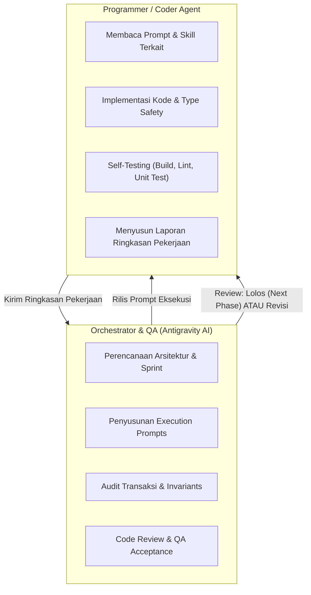

# AGENTS.md — Protokol Kerja Kolaborasi Multi-Agent SAKODE

Dokumen ini adalah pedoman utama operasional seluruh AI Agent yang bekerja pada repositori **SAKODE Task & Reward Platform** (SAKODE Academy).

---

## 1. Pembagian Peran (Role Division)



| Agen | Posisi | Tanggung Jawab Utama |
|---|---|---|
| **Orchestrator / Planner / QA** | Antigravity AI | Merancang roadmap, membuat prompt eksekusi, mengaudit keamanan/transaksi Firestore, memvalidasi kriteria penerimaan, dan menentukan status *Approved* atau *Revision Required*. |
| **Programmer / Coder Agent** | AI Agent Pelaksana | Menulis kode TypeScript/Next.js, mengonfigurasi Tailwind & Firebase, menjalankan build/lint, melakukan self-testing, dan menyajikan ringkasan pengerjaan. |

---

## 2. Integrasi Skill Lokal (`AGENT-SKILLS`)

Coder Agent memiliki akses ke seluruh skill web development yang terpasang di direktori:
📂 `C:\Users\yogaa\Document Local\AGENT-SKILLS\skills`

Sebelum mengeksekusi prompt, Coder Agent **DIHARUSKAN** membaca dan menerapkan pedoman dari skill yang relevan sesuai tabel pemetaan berikut:

| Kebutuhan Pengerjaan | Skill Rujukan Wajib (`AGENT-SKILLS\skills\...`) | Fokus Penerapan |
|---|---|---|
| **Desain Antarmuka & Estetika** | `frontend-design` | Hindari estetika "AI slop" generik; terapkan tone SAKODE (profesional komunitas IT dengan sentuhan halus RPG); komposisi ruang dan hierarki visual tajam. |
| **Design System & Tokens** | `tailwind-design-system` | Konfigurasi token CSS/Tailwind, semantic color tokens, utility consistency, dan skalabilitas komponen UI. |
| **Keamanan & Validasi Data** | `security-best-practices`<br/>`security-threat-model` | Pencegahan privilege escalation, validasi server-side Zod, pengamanan transaksi Firestore atomik, masking data rekening, sanitasi input. |
| **Aksesibilitas & Standar UI** | `web-design-guidelines` | Keyboard navigation, focus states, kontras rasio warna (WCAG AA), aria-labels, touch target min 44px di mobile. |
| **Komponen UI Primitif** | `shadcn` | Pola komponen headless / accessible primitives untuk dialog, popover, dropdown, dan form controls. |
| **Animasi & Interaksi Halus** | `animate` | Transisi status halus, feedback loading, micro-interactions pada tombol/badge tanpa berlebihan. |

---

## 3. Alur Kerja Tektokan (Execution & Review Cycle)

Setiap tahapan pengembangan mengikuti siklus 4 langkah:

```
[Langkah 1: Orchestrator] Membuat & Merilis Prompt Eksekusi (Sprint X.Y)
           │
           ▼
[Langkah 2: Coder Agent] Membaca Skill Terkait -> Menulis Kode -> Self-Testing (Build/Lint)
           │
           ▼
[Langkah 3: Coder Agent] Mengirimkan Ringkasan Pekerjaan (Format Standar)
           │
           ▼
[Langkah 4: Orchestrator] Melakukan Code Review & QA Gate
           ├── JIKA ADA CACAT -> Rilis Instruksi Revisi (Kembali ke Langkah 2)
           └── JIKA LOLOS -> Status APPROVED -> Rilis Prompt Sprint Selanjutnya
```

---

## 4. Strict Invariants (Hukum Baku yang Tidak Boleh Dilanggar)

Coder Agent **WAJIB** mematuhi 8 invariant berikut pada setiap baris kode yang ditulis:

1. **Uang adalah Integer Rupiah**: Semua nilai finansial disimpan sebagai **Integer IDR** (contoh: Rp 250.000 disimpan `250000`). Dilarang float/desimal.
2. **Zona Waktu UTC -> WIB**: Database Firestore menyimpan timestamp dalam UTC (`Timestamp.now()`). Tampilan UI mutlak menggunakan zona waktu **Asia/Jakarta (WIB)**.
3. **Validasi Deadline Tanpa Cron (Zero Cron Rule)**: Pengecekan apakah task sudah lewat deadline wajib diverifikasi di sisi server via *Server Timestamp* pada saat mutasi diproses. Status di UI hanyalah turunan visual.
4. **Batas 1 Active Task & 3 Pending Applications**:
   - 1 Member hanya boleh memiliki **1 Active Task** dalam satu waktu (Solo atau Team).
   - Maksimal **3 Application** pending per member. Saat 1 aplikasi terpilih, aplikasi lain ditarik otomatis tanpa penalti.
5. **Transaksi Atomik Firestore**: Seluruh mutasi assignment task (Instant Take), pemilihan applicant, klaim reward, approval review, dan konsensus tim **wajib** menggunakan `firestore.runTransaction()`.
6. **Perlindungan Data Rekening**: Data rekening/e-wallet dienkripsi di aplikasi sebelum disimpan, di-mask pada tampilan umum (`BCA ****1234`), dan di-snapshot pada dokumen claim.
7. **Append-Only Audit Trail**: Koleksi `auditEvents` hanya boleh menerima operasi `create`/`add`. Tidak ada update atau delete pada riwayat audit.
8. **Bahasa Antarmuka**: Seluruh teks tombol, badge status, modal, notifikasi, dan pesan kesalahan wajib menggunakan **Bahasa Indonesia** yang baku, lugas, dan profesional.

---

## 5. Standar Format Ringkasan Pekerjaan Coder Agent

Coder Agent **wajib** melaporkan hasil eksekusinya menggunakan format berikut agar dapat diproses oleh QA:

```markdown
### [RINGKASAN PEKERJAAN: <KODE_TASK>]

#### 1. Implementasi yang Dilakukan
- <Penjelasan fitur/komponen yang dibuat/diubah>

#### 2. Skill AGENT-SKILLS yang Digunakan
- `<nama-skill>`: <Bagaimana panduan skill diterapkan pada kode>

#### 3. Berkas yang Dibuat / Dimodifikasi
- [path/to/file.ts](file:///...) - <Fungsi berkas>

#### 4. Hasil Verifikasi Mandiri (Self-Check)
- `npm run build`: [Lolos / Gagal]
- `npm run lint` / Typecheck: [Lolos / Gagal]
- Pengujian unit/manual: [Catatan pengujian]

#### 5. Checklist Acceptance Criteria
- [x] Kriteria 1
- [x] Kriteria 2

#### 6. Catatan Teknis untuk QA
- <Catatan konfigurasi env, Firestore indexes, atau keputusan arsitektur>
```

---

## 6. Rubrik Keputusan QA (Orchestrator)

Orchestrator akan mengevaluasi ringkasan dan kode berdasarkan 6 kriteria:
1. **Arsitektur & Type Safety**: Kesesuaian dengan Next.js App Router, pemisahan layer, zero unhandled errors, strict TypeScript.
2. **Penegakan Invariants**: Firestore transaction atomicity, batas 1 active task, rupiah integer, UTC/WIB.
3. **Kepatuhan Desain SAKODE**: Penggunaan warna resmi (`#71CFFE`, `#BC71FE`, `#F9723B`, `#172033`, `#DBE8F0`, `#F7FBFE`), font Nunito, radius 8px, responsif mobile.
4. **Penerapan Skill**: Kode mencerminkan standar dari skill `frontend-design`, `security-best-practices`, dan `tailwind-design-system`.
5. **Kebersihan Error Handling**: Pesan error informatif dalam Bahasa Indonesia.
6. **Kelengkapan Acceptance Criteria**: Seluruh kriteria dalam prompt terpenuhi.

Status akhir review akan dirilis sebagai salah satu dari:
* **`APPROVED`**: Memenuhi standar, siap lanjut ke prompt sprint berikutnya.
* **`REQUEST_CHANGES`**: Memerlukan perbaikan dengan instruksi spesifik pada file dan baris yang bersangkutan.
