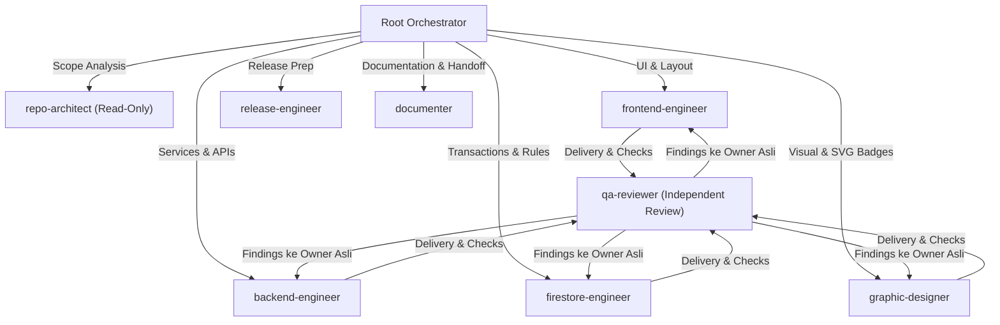

# AGENTS.md — Protokol Kolaborasi Multi-Agent SAKODE

Dokumen ini adalah acuan tata kelola dan pedoman operasional utama bagi seluruh AI Agent yang beroperasi di repositori **SAKODE Task & Reward Platform** (`sakode-task-reward`).

---

## 1. Roster Agent Reusable (Fixed Registry)

Kolaborasi multi-agent menggunakan fixed workspace agents dengan spesialisasi domain yang stabil. Dilarang membuat agent berbasis halaman, fitur, sprint, atau bug tertentu.



| Agent | Peran & Domain Utama | Kewenangan Utama | File Definisi |
|---|---|---|---|
| **`repo-architect`** | Eksplorasi codebase, tracing execution path, batas subsystem, cross-layer contract | Read-only; dilarang mutasi berkas | [repo-architect.md](file:///.agents/agents/repo-architect.md) |
| **`frontend-engineer`** | Design system, token, komponen UI, halaman/layout, client state, responsivitas, a11y, motion | `src/app/**`, `src/components/**`, `src/context/**`, styling | [frontend-engineer.md](file:///.agents/agents/frontend-engineer.md) |
| **`backend-engineer`** | Server Actions, Route Handlers, service domain, Zod validations, auth, encryption, email/FCM | `src/server/**`, `src/lib/validations/**`, `src/app/api/**`, lib | [backend-engineer.md](file:///.agents/agents/backend-engineer.md) |
| **`firestore-engineer`** | Firestore schema, transaksi atomik, Security Rules, indexes, concurrency safety, seed scripts | `firestore.rules`, `firestore.indexes.json`, `src/types/database.ts` | [firestore-engineer.md](file:///.agents/agents/firestore-engineer.md) |
| **`graphic-designer`** | Desain medallion SVG, ikonografi pilar, badge gamifikasi, vektorisasi visual | `public/badges/**`, `public/images/**`, visual assets | [graphic-designer.md](file:///.agents/agents/graphic-designer.md) |
| **`qa-reviewer`** | Independent code review, verifikasi invariants, keamanan, RBAC, a11y, regresi | Read-only; dilarang edit kode, temuan dikirim ke owner | [qa-reviewer.md](file:///.agents/agents/qa-reviewer.md) |
| **`release-engineer`** | Build readiness, env validation, Firebase/Vercel deployment prep, release checklist | Read-only/prep; dilarang deploy langsung tanpa izin | [release-engineer.md](file:///.agents/agents/release-engineer.md) |
| **`documenter`** | Pemeliharaan AGENTS.md, framework docs, arsitektur, changelog, proposed commits | Berkas dokumentasi (`AGENTS.md`, `docs/**`, `*.md`) | [documenter.md](file:///.agents/agents/documenter.md) |

---

## 2. Invariant Mutlak Bisnis SAKODE (18 Strict Invariants)

Seluruh agent wajib mematuhi 18 invariant berikut pada setiap baris kode dan rancangan:

1. **Uang adalah Integer Rupiah**: Semua nilai finansial disimpan sebagai **Integer IDR** murni tanpa floating point atau desimal.
2. **Penyimpanan UTC & Tampilan WIB**: Timestamp disimpan di Firestore dalam UTC (`Timestamp.now()`). Tampilan UI pengguna wajib zona waktu **Asia/Jakarta (WIB)**.
3. **Validasi Deadline Sisi Server (Zero-Cron Rule)**: Batas waktu divalidasi langsung di server saat mutasi; UI hanya derivasi visual.
4. **Batas 1 Active Task**: 1 Member maksimal hanya boleh memiliki **1 Active Task** yang sedang berjalan (Solo maupun Tim).
5. **Batas 3 Pending Applications**: Maksimal **3 Application** pending per member. Pemilihan satu aplikasi otomatis membatalkan aplikasi lain secara aman.
6. **Transaksi Atomik Wajib**: Mutasi assignment task, pemilihan applicant, klaim reward, review-lock, dan konsensus tim wajib menggunakan `firestore.runTransaction()`.
7. **Append-Only Audit Trail**: Koleksi `auditEvents` bersifat append-only (`create`/`add` saja, tanpa update/delete).
8. **Bahasa Antarmuka Baku**: Seluruh antarmuka, pesan error, modal, dan notifikasi wajib menggunakan **Bahasa Indonesia** yang baku, lugas, dan profesional.
9. **Enkripsi Rekening**: Data nomor rekening/e-wallet wajib dienkripsi di aplikasi sebelum disimpan ke Firestore.
10. **Masking Rekening**: Data rekening wajib di-mask pada tampilan antarmuka (`BCA ****1234`).
11. **Snapshot Rekening Klaim**: Dokumen klaim membekukan snapshot rekening saat klaim diajukan.
12. **Konsensus Tim 100%**: Reward tim mewajibkan persetujuan pembagian 100% dari seluruh anggota sebelum pencairan diproses.
13. **Collision Lock Review Admin**: Antrean review wajib mencegah tabrakan pengerjaan antar-admin (*review lock*).
14. **Idempotensi Finansial**: Seluruh operasi finansial wajib bersifat idempoten untuk mencegah eksekusi ganda.
15. **Eskalasi Conflict-of-Interest**: Konflik kepentingan peninjauan dialihkan ke admin independen atau Super Admin.
16. **Otorisasi Bukti Media**: Akses media bukti pengerjaan dibatasi sesuai hak akses peran pengguna.
17. **Penarikan Aplikasi Tanpa Penalti**: Penarikan otomatis aplikasi lain saat task diterima tidak memberikan sanksi/penalti.
18. **Desain & Aksesibilitas Resmi**: Font `Nunito`, token warna SAKODE, touch target mobile minimal `44px`, WCAG AA.

---

## 3. Protokol Komunikasi JSON Antar-Agent

Seluruh instruksi, laporan, handoff, dan peninjauan menggunakan format JSON ringkas:

```json
// 1. Task Assignment (Root -> Agent)
{
  "v": 1,
  "type": "task",
  "id": "TASK-ID",
  "from": "root",
  "to": "target-engineer",
  "goal": "Tujuan pekerjaan",
  "scope": ["path/domain"],
  "skills": ["nama-skill"],
  "allowed": ["read", "edit:path/**", "run:npm run lint"],
  "forbidden": ["define_subagent", "invoke_subagent", "git-write"],
  "done_when": ["Kriteria selesai"]
}

// 2. Result Report (Agent -> Root)
{
  "v": 1,
  "type": "result",
  "id": "TASK-ID",
  "from": "target-engineer",
  "status": "done",
  "summary": "Ringkasan pekerjaan",
  "files": ["src/..."],
  "evidence": ["file:line", "command=PASS"],
  "checks": ["lint=PASS", "typecheck=PASS"]
}

// 3. QA Review Findings (qa-reviewer -> Root -> Owner Asli)
{
  "v": 1,
  "type": "review",
  "task": "TASK-ID",
  "status": "changes_requested",
  "findings": [
    {
      "severity": "critical",
      "owner": "target-engineer",
      "file": "path",
      "line": 12,
      "issue": "Uraian temuan",
      "expected": "Perilaku yang benar"
    }
  ]
}
```

---

## 4. Siklus Pengerjaan & Quality Gate

1. **Root Orchestrator** mengklasifikasikan tugas, memverifikasi kontrak, dan menugaskan agent minimum dari roster tetap.
2. **Implementer** mengimplementasikan kode, membaca skill terkait di `.agents/skills/`, dan menjalankan self-check (`npm run lint`, `npx tsc --noEmit`).
3. **Independent Review** dilakukan oleh `qa-reviewer` (read-only). Jika ada temuan, perbaikan dikembalikan kepada owner asli.
4. **Documenter** memperbarui dokumentasi setelah kode stabil.
5. **Git Safety Gate**: Dilarang menjalankan operasi Git mutatif (`add`, `commit`, `push`, `clean`). Root menyusun *Proposed Commit Message* berbasis Conventional Commits.
