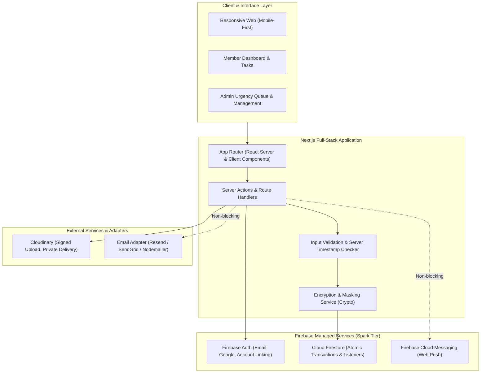

# ARCHITECTURE.md — Arsitektur Teknis SAKODE Task & Reward Platform

Dokumen ini menjelaskan arsitektur menyeluruh dari sistem, model data Firestore, mekanisme proteksi konkurensi, dan integrasi modul backend sesuai spesifikasi resmi.

---

## 1. Diagram Arsitektur Sistem



---

## 2. Modul Aplikasi & Tanggung Jawab

| Modul | Tanggung Jawab | File Layer Utama |
|---|---|---|
| **Identity & Access** | Autentikasi, penautan akun Google, enkripsi data rekening, verifikasi profil admin. | `src/server/services/auth.service.ts` |
| **Task Management** | CRUD task, validasi durasi/deadline tanpa cron, penerbitan snapshot terms. | `src/server/services/task.service.ts` |
| **Assignment Engine** | Transaksi atomik Instant Take, manajemen 3 pending application, auto-withdraw. | `src/server/services/assignment.service.ts` |
| **Team Management** | Recruitment tim, kode undangan, kesepakatan prinsip pembagian reward, penguncian roster. | `src/server/services/team.service.ts` |
| **Submission & Review** | Cloudinary signed upload, atomic review locking admin, revisi, dan perpanjangan waktu. | `src/server/services/submission.service.ts` |
| **Partial & Appeal Engine**| Partial completion, pembentukan linked continuation task, alur 1x appeal admin independen. | `src/server/services/appeal.service.ts` |
| **Reward & Claim Ledger** | Pengelolaan item reward integer IDR, batch claim solo, idempotency, konsensus tim 100%. | `src/server/services/claim.service.ts` |
| **Report & Penalty** | Pelaporan masalah berbukti, aturan anti-konflik kepentingan admin, kalkulasi penalti. | `src/server/services/report.service.ts` |
| **Notification Center** | In-app notification inbox Firestore, push FCM, dan pengiriman email transaksional. | `src/server/services/notification.service.ts` |
| **Audit Service** | Pencatatan append-only seluruh mutasi sensitif beserta snapshot sebelum dan sesudah. | `src/server/services/audit.service.ts` |

---

## 3. Skema Data Firestore (Koleksi Utama)

### 1. `users`
* `id`: Firebase UID utama (string)
* `email`: string
* `displayName`: string
* `contactNumber`: string
* `skills`: string[] (tag keahlian member)
* `role`: `'SUPER_ADMIN' | 'ADMIN' | 'MEMBER'`
* `approvalStatus`: `'PENDING' | 'APPROVED' | 'REJECTED'`
* `paymentAccountEncrypted`: string (enkripsi AES-256 info bank/e-wallet)
* `paymentAccountMasked`: string (misal: "BCA ****5678 a.n J*** D**")
* `activeTaskId`: string | null (id task yang sedang aktif dipegang)
* `pendingApplicationCount`: number (0 s.d 3)
* `stats`: `{ completedTasks: number, onTimeTasks: number, failedTasks: number, provenReports: number }`
* `createdAt`, `updatedAt`: Firestore Timestamp

### 2. `tasks`
* `id`: string
* `title`: string
* `description`: string
* `scope`: string
* `deliverableGuidelines`: string
* `acceptanceCriteria`: string[]
* `mode`: `'SOLO' | 'TEAM'`
* `assignmentType`: `'INSTANT_TAKE' | 'APPLICATION'`
* `requiredSkills`: string[]
* `totalReward`: number (Integer Rupiah)
* `deadlineType`: `'FIXED' | 'DURATION'`
* `fixedDeadlineAt`: Firestore Timestamp | null
* `durationMinutes`: number | null
* `deadlineAt`: Firestore Timestamp | null (waktu batas aktual yang dihitung)
* `status`: `'DRAFT' | 'OPEN' | 'RECRUITING' | 'READY' | 'ACTIVE' | 'SUBMITTED' | 'IN_REVIEW' | 'REVISION' | 'APPEALED' | 'APPROVED' | 'PARTIAL' | 'FAILED' | 'CLOSED'`
* `termsSnapshot`: `{ version: number, content: string, capturedAt: Firestore Timestamp }`
* `assignedUserId`: string | null
* `assignedTeamId`: string | null
* `reviewLockedByAdminId`: string | null
* `reviewLockedUntil`: Firestore Timestamp | null
* `parentTaskId`: string | null (jika merupakan Continuation Task)
* `continuationTaskId`: string | null (jika task ini menghasilkan kelanjutan)
* `createdByAdminId`: string
* `createdAt`, `updatedAt`: Firestore Timestamp

### 3. `applications`
* `id`: string
* `taskId`: string
* `userId`: string
* `message`: string
* `portfolioLinks`: string[]
* `status`: `'PENDING' | 'ACCEPTED' | 'REJECTED' | 'WITHDRAWN'`
* `withdrawalReason`: string | null
* `createdAt`, `updatedAt`: Firestore Timestamp

### 4. `teams`
* `id`: string
* `taskId`: string
* `teamLeadUserId`: string
* `minMembers`: number
* `maxMembers`: number
* `memberCount`: number
* `rosterLocked`: boolean
* `initialSplitPrinciple`: `'EQUAL' | 'CONTRIBUTION_BASED'`
* `inviteCode`: string
* `status`: `'RECRUITING' | 'READY' | 'ACTIVE'`
* `createdAt`, `updatedAt`: Firestore Timestamp

### 5. `teamMemberships`
* `id`: string
* `teamId`: string
* `taskId`: string
* `userId`: string
* `roleInTeam`: `'LEAD' | 'MEMBER'`
* `status`: `'INVITED' | 'APPLIED' | 'APPROVED' | 'TERMS_ACCEPTED'`
* `agreedTermsAt`: Firestore Timestamp | null
* `createdAt`: Firestore Timestamp

### 6. `submissions`
* `id`: string
* `taskId`: string
* `submittedByUserId`: string
* `teamId`: string | null
* `version`: number
* `notes`: string
* `deliverableLinks`: string[]
* `evidenceFiles`: array of `{ url: string, publicId: string, fileName: string, fileType: string, fileSize: number }`
* `status`: `'SUBMITTED' | 'IN_REVIEW' | 'REVISION_REQUESTED' | 'APPROVED' | 'PARTIAL' | 'REJECTED'`
* `revisionNotes`: string | null
* `revisionDeadlineAt`: Firestore Timestamp | null
* `extensionReason`: string | null
* `appeal`: `{ appealedByUserId: string, reason: string, evidenceFiles: any[], filedAt: Firestore Timestamp } | null`
* `reviewedByAdminId`: string | null
* `createdAt`, `updatedAt`: Firestore Timestamp

### 7. `rewardLedgers`
* `id`: string
* `taskId`: string
* `ownerUserId`: string
* `teamId`: string | null
* `amount`: number (Integer Rupiah)
* `status`: `'AVAILABLE' | 'CLAIMED'`
* `claimId`: string | null
* `createdAt`, `updatedAt`: Firestore Timestamp

### 8. `claims`
* `id`: string
* `userId`: string
* `rewardLedgerIds`: string[]
* `totalAmount`: number (Integer Rupiah)
* `bankAccountSnapshot`: `{ bankName: string, accountNumber: string, accountHolderName: string }`
* `status`: `'CLAIMED' | 'PROCESSING' | 'PAID' | 'CONFIRMED'`
* `transferProofUrl`: string | null
* `idempotencyKey`: string (unique per claim attempt)
* `processedByAdminId`: string | null
* `processedAt`: Firestore Timestamp | null
* `confirmedAt`: Firestore Timestamp | null
* `createdAt`, `updatedAt`: Firestore Timestamp

### 9. `teamDistributions`
* `id`: string
* `taskId`: string
* `teamId`: string
* `totalReward`: number (Integer Rupiah)
* `allocations`: array of `{ userId: string, amount: number, agreed: boolean, agreedAt: Firestore Timestamp | null }`
* `consensusReached`: boolean
* `paidToLeadByAdmin`: boolean
* `leadTransferProofs`: array of `{ memberUserId: string, proofUrl: string, uploadedAt: Firestore Timestamp, confirmedByMember: boolean, confirmedAt: Firestore Timestamp | null }`
* `createdAt`, `updatedAt`: Firestore Timestamp

### 10. `reports`
* `id`: string
* `reporterUserId`: string
* `targetType`: `'TASK' | 'SUBMISSION' | 'CLAIM' | 'TEAM_DISTRIBUTION'`
* `targetId`: string
* `category`: string
* `chronology`: string
* `evidenceFiles`: any[]
* `status`: `'SUBMITTED' | 'UNDER_REVIEW' | 'NEED_MORE_EVIDENCE' | 'RESOLVED' | 'REJECTED'`
* `assignedAdminId`: string | null
* `resolutionNotes`: string | null
* `createdAt`, `updatedAt`: Firestore Timestamp

### 11. `penalties`
* `id`: string
* `userId`: string
* `reportId`: string | null
* `type`: `'WARNING' | 'COOLDOWN' | 'TEAM_ONLY' | 'NO_LEAD' | 'TEMPORARY_SUSPEND' | 'ACCOUNT_SUSPEND'`
* `validUntil`: Firestore Timestamp | null
* `reason`: string
* `issuedByAdminId`: string
* `isOverridden`: boolean
* `overrideReason`: string | null
* `createdAt`: Firestore Timestamp

### 12. `auditEvents` (Append-Only)
* `id`: string
* `actorId`: string
* `actorRole`: string
* `action`: string (misal: `TASK_ASSIGNED`, `REWARD_CLAIM_PAID`, `PENALTY_OVERRIDDEN`)
* `entityType`: string
* `entityId`: string
* `beforeSnapshot`: any | null
* `afterSnapshot`: any | null
* `reason`: string | null
* `timestamp`: Firestore Timestamp

---

## 4. Mekanisme Proteksi Konkurensi & Integritas Data

### A. Transaksi Atomik Instant Take (Mencegah Double Assignment)
```typescript
await firestore.runTransaction(async (transaction) => {
  const userRef = firestore.collection('users').doc(userId);
  const taskRef = firestore.collection('tasks').doc(taskId);

  const [userDoc, taskDoc] = await Promise.all([
    transaction.get(userRef),
    transaction.get(taskRef),
  ]);

  const userData = userDoc.data();
  const taskData = taskDoc.data();

  // 1. Verifikasi Invariant: User belum memegang Active Task
  if (userData?.activeTaskId) {
    throw new Error('Member sedang memiliki task aktif yang belum selesai.');
  }

  // 2. Verifikasi Status Task masih OPEN
  if (taskData?.status !== 'OPEN') {
    throw new Error('Task sudah tidak tersedia atau telah diambil orang lain.');
  }

  // 3. Mutasi atomik bersamaan
  transaction.update(taskRef, {
    status: 'ACTIVE',
    assignedUserId: userId,
    deadlineAt: calculateDeadline(taskData),
    updatedAt: FieldValue.serverTimestamp(),
  });

  transaction.update(userRef, {
    activeTaskId: taskId,
    updatedAt: FieldValue.serverTimestamp(),
  });
});
```

### B. Shared Review Queue Locking (Mencegah Tabrakan Antar Admin)
* Saat seorang Admin membuka submission untuk dinilai, sistem menempatkan kunci sementara (`reviewLockedByAdminId = adminId` dan `reviewLockedUntil = now + 15 menit`).
* Jika admin lain membuka submission yang sama, tombol aksi penilaian di-disable dengan informasi *"Sedang diperiksa oleh Admin [Nama]"*.
* Jika waktu kunci 15 menit terlampaui tanpa aksi, kunci kedaluwarsa secara otomatis.

### C. Alur Konsensus Reward Tim 100%
1. Team Lead mengajukan daftar alokasi nominal (`total alokasi == total reward`).
2. Setiap anggota mendapatkan notifikasi dan prompt persetujuan di dashboard.
3. Seluruh anggota harus mencentang `agreed = true`.
4. Jika terdapat satu anggota menolak (`agreed = false`), proposal otomatis kembali ke status diskusi (*deliberation*).
5. Hanya setelah `consensusReached == true`, tombol pencairan dibuka untuk Team Lead.

---

## 5. Keamanan & Kebijakan Data Sensitif

1. **Enkripsi Rekening**: Nomor rekening dan nama pemilik bank dienkripsi menggunakan AES-GCM 256-bit dengan kunci master (`ENCRYPTION_SECRET_KEY`) sebelum disimpan ke Firestore.
2. **Masking Rekening di UI**: Di luar panel transfer admin berwenang, nomor rekening ditampilkan dalam format aman, misal: `Bank BCA — •••• 5678`.
3. **Penyimpanan Berkas Privat (Cloudinary)**: Bukti pekerjaan dan bukti transfer diunggah via URL bertanda tangan (*Signed Upload*). Akses file menggunakan token kedaluwarsa (*authenticated delivery*), mencegah akses publik ilegal.
4. **Prinsip Anti-Konflik Kepentingan (Conflict of Interest)**:
   * Jika seorang Admin terlibat dalam pembuatan task, review submission, atau transfer dana yang dilaporkan, Admin tersebut dilarang memproses laporan terkait.
   * Laporan yang mencatut Admin otomatis dialihkan secara eksklusif ke antrean **Super Admin**.
