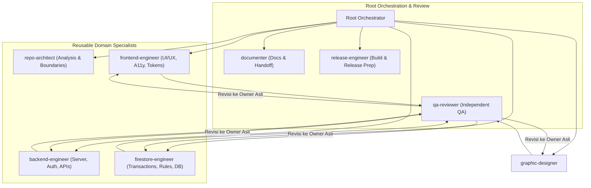

# SAKODE Task & Reward Platform — Framework Orkestrasi Multi-Agent

Dokumen ini adalah acuan arsitektur orkestrasi kolaborasi multi-agent di repositori **SAKODE Task & Reward Platform** (`sakode-task-reward`).

---

## 1. Filosofi & Arsitektur Roster Tetap (Fixed Reusable Roster)

Antigravity beroperasi dengan prinsip:
> **"Specialization belongs to the task, not to the agent identity."**

Agent merepresentasikan domain keahlian yang stabil. Spesialisasi sementara diberikan melalui payload task terstruktur. Dilarang keras membuat agent sementara (*transient agents*) atau agent yang dinamai berdasarkan halaman, fitur, sprint, atau bug.



---

## 2. Roster Agent & Matriks Kepemilikan Berkas (File Ownership)

Setiap implementasi memiliki batasan kepemilikan berkas (*file ownership*) yang eksklusif untuk mencegah konflik:

| Agent | File Ownership Baseline | Pengecualian / Larangan |
|---|---|---|
| **`repo-architect`** | Read-only di seluruh repositori | Dilarang memodifikasi berkas apapun |
| **`frontend-engineer`** | `src/app/**`, `src/components/**`, `src/context/**`, `src/app/globals.css`, `tailwind.config.ts` | Tidak memiliki `src/app/api/**` dan `src/server/**` |
| **`backend-engineer`** | `src/server/actions/**`, `src/server/services/**`, `src/lib/validations/**`, `src/app/api/**`, `src/lib/cloudinary.ts`, `src/lib/crypto.ts` | Tidak memaparkan secret / admin SDK ke client |
| **`firestore-engineer`** | `firestore.rules`, `firestore.indexes.json`, `firebase.json`, `src/types/database.ts`, `scripts/seed-database.mjs`, `scripts/run-concurrency-test.mjs` | Dilarang seed/reset/deploy ke target non-emulator tanpa izin |
| **`graphic-designer`** | `public/badges/**`, `public/images/**`, `public/illustrations/**`, `scripts/build_*badges*.py` | Dilarang menyentuh logika bisnis, data, dan server |
| **`qa-reviewer`** | Read-only di seluruh repositori | Dilarang memperbaiki temuan sendiri; temuan dikirim ke owner asli |
| **`release-engineer`** | Konfigurasi deployment, build script, environment check | Dilarang deploy production tanpa izin eksplisit pengguna |
| **`documenter`** | `AGENTS.md`, `ARCHITECTURE.md`, `DESIGN.md`, `PLANNING.md`, `README.md`, `docs/**`, `CHANGELOG.md` | Dilarang menyentuh kode produk aplikasi |

---

## 3. Alur Kerja Berbasis Kontrak (Contract-First Workflow)

Sebelum implementasi frontend dan backend berjalan secara paralel, Root menetapkan kontrak teknis lintas layer:

```json
{
  "type": "contract",
  "id": "C-01",
  "feature": "Nama Fitur",
  "actors": ["MEMBER", "ADMIN"],
  "input": {
    "taskId": "string (zod uuid/alphanumeric)",
    "payload": "object"
  },
  "output": {
    "success": true,
    "data": {}
  },
  "errors": [
    { "code": "ACTIVE_TASK_EXISTS", "message": "Anda masih memiliki task aktif." }
  ],
  "authorization": "Wajib terautentikasi dan status approved",
  "validation": "src/lib/validations/task.ts",
  "firestore": {
    "reads": ["tasks/{taskId}", "users/{userId}"],
    "writes": ["tasks/{taskId}", "auditEvents/{eventId}"],
    "transaction_required": true
  },
  "audit_event": "TASK_ASSIGNED",
  "notifications": ["FCM ke admin"],
  "owners": {
    "frontend": "frontend-engineer",
    "backend": "backend-engineer",
    "data": "firestore-engineer"
  }
}
```

---

## 4. Protokol JSON Antar-Agent

### A. Penugasan Tugas (`task`)
```json
{
  "v": 1,
  "type": "task",
  "id": "FE-01",
  "from": "root",
  "to": "frontend-engineer",
  "goal": "Implementasi kartu task responsif",
  "scope": ["src/components/tasks/**"],
  "skills": ["frontend-design", "tailwind-design-system"],
  "allowed": ["read", "edit:src/components/tasks/**", "run:npm run lint"],
  "forbidden": ["define_subagent", "invoke_subagent", "git-write"],
  "inputs": ["C-01"],
  "deliverables": ["src/components/tasks/TaskCard.tsx"],
  "done_when": ["WCAG AA compliant", "Touch target >= 44px", "Lint PASS"],
  "depends_on": []
}
```

### B. Laporan Penyelesaian (`result`)
```json
{
  "v": 1,
  "type": "result",
  "id": "FE-01",
  "from": "frontend-engineer",
  "status": "done",
  "summary": "Komponen TaskCard selesai dengan token resmi SAKODE",
  "files": ["src/components/tasks/TaskCard.tsx"],
  "evidence": ["src/components/tasks/TaskCard.tsx:45", "npm run lint=PASS"],
  "checks": ["lint=PASS", "typecheck=PASS"]
}
```

### C. Handoff Antar-Agent (`handoff`)
```json
{
  "v": 1,
  "type": "handoff",
  "from": "backend-engineer",
  "to": "frontend-engineer",
  "contract": "C-01",
  "summary": "Server action selesai diekspor di src/server/actions/task.ts",
  "artifacts": ["src/server/actions/task.ts"],
  "constraints": ["Gunakan Server Action via useActionState atau form action"]
}
```

### D. Hasil Peninjauan QA (`review`)
```json
{
  "v": 1,
  "type": "review",
  "task": "FE-01",
  "status": "changes_requested",
  "findings": [
    {
      "severity": "major",
      "owner": "frontend-engineer",
      "file": "src/components/tasks/TaskCard.tsx",
      "line": 48,
      "issue": "Touch target tombol aksi hanya 36px, di bawah standar 44px",
      "expected": "Tambahkan class min-h-[44px] min-w-[44px]"
    }
  ],
  "checks": ["lint=PASS"]
}
```

---

## 5. Review Loop & Quality Gates

1. **Implementer** menyelesaikan pekerjaan dan menjalankan verifikasi mandiri (`npm run lint`, `npx tsc --noEmit`).
2. **Root** mengevaluasi diff dan output command.
3. **`qa-reviewer`** menjalankan independent code review tanpa menyentuh kode.
4. Jika ada temuan, instruksi revisi dikembalikan kepada **agent pemilik mula-mula**. Agent baru dilarang dibuat.
5. Setelah lolos review, **`documenter`** memperbarui dokumentasi terkait.
6. **Git Safety Gate**: Dilarang menjalankan perintah mutasi git (`git add`, `git commit`, `git push`). Root menyajikan *Proposed Commit Message* menggunakan format Conventional Commits.
