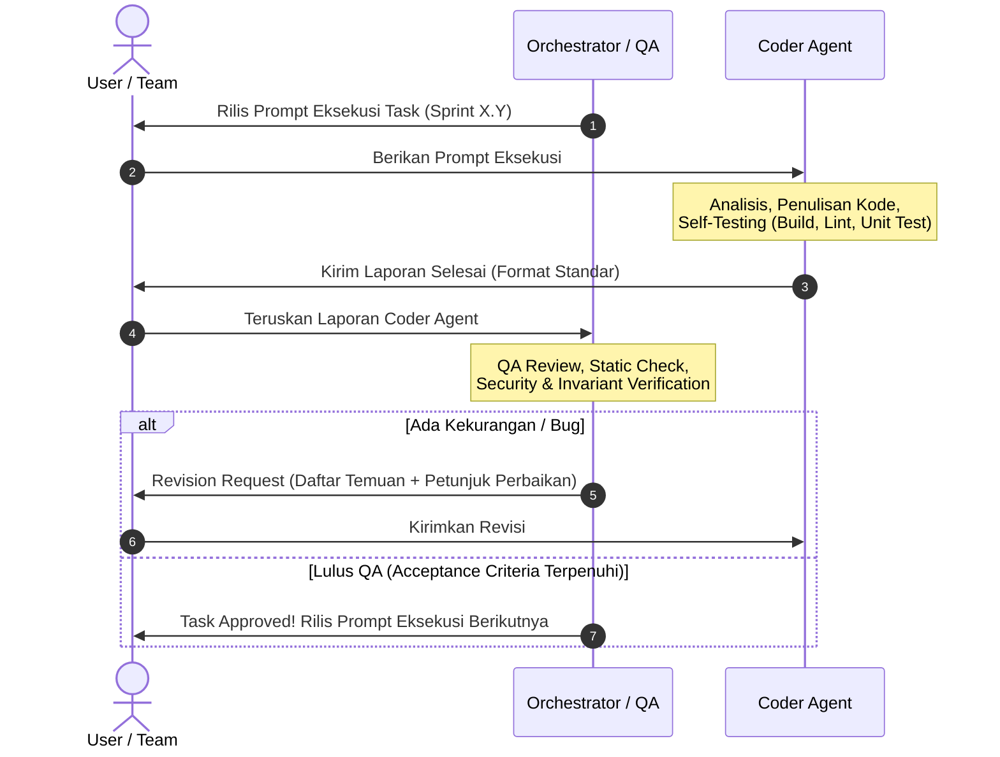

# SAKODE Task & Reward Platform - Agent Collaboration Protocol

Dokumen ini adalah acuan kerja sama antara **Orchestrator / Planner / QA Agent** dengan **Coder / Programmer Agent**.

---

## 1. Peran & Tanggung Jawab

| Peran | Pemegang | Tanggung Jawab |
|---|---|---|
| **Orchestrator / Planner** | Antigravity AI | Memecah spesifikasi menjadi task atomik, menetapkan arsitektur, kriteria penerimaan, dan rule teknis. |
| **Coder Agent** | Programmer Agent | Menulis kode, membuat file konfigurasi, menjalankan build/lint, melakukan self-testing, dan melaporkan hasil kerja. |
| **Reviewer & QA** | Antigravity AI | Memverifikasi kepatuhan arsitektur, keamanan transaksi Firestore, kualitas kode, akurasi design tokens, dan acceptance criteria. |

---

## 2. Siklus Kerja Tektokan (Workflow Loop)



---

## 3. Strict Invariants (Hukum Mutlak Proyek SAKODE)

Semua kode yang ditulis Coder Agent **WAJIB** tunduk pada invariant berikut tanpa pengecualian:

1. **Mata Uang Finansial**:
   - Seluruh nominal reward disimpan sebagai **Integer Rupiah** (IDR, tanpa floating point, tanpa desimal). Contoh: `Rp 150.000` disimpan sebagai `150000`.
2. **Zona Waktu & Tanggal**:
   - Disimpan di Firestore dalam format UTC (`admin.firestore.Timestamp` / ISO UTC).
   - Ditampilkan di UI pengguna dalam zona waktu **Asia/Jakarta (WIB)**.
3. **No-Cron Deadline Validation**:
   - Status batas waktu divalidasi langsung di sisi server (`Server Timestamp`) pada setiap mutasi data sensitif. UI hanya menampilkan derivasi visual.
4. **Pembatasan Task & Application**:
   - 1 Member aktif hanya boleh memiliki **maksimal 1 Active Task** (baik Solo maupun Team).
   - Maksimal **3 Application** pending per member. Ketika terpilih pada 1 task, aplikasi lain otomatis dibatalkan (`withdrawn`) tanpa penalti.
5. **Integritas Firestore**:
   - Setiap mutasi finansial, klaim reward, instant take task, dan perubahan status tim **wajib** menggunakan Firestore Transactions (`runTransaction`).
   - Audit trail bersifat **Append-Only** (hanya `create`, tidak ada `update` atau `delete`).
6. **Privasi Rekening Bank / E-Wallet**:
   - Data rekening dienkripsi di level aplikasi sebelum masuk Firestore.
   - Tampilan UI selalu menggunakan format masked (contoh: `BCA ****5678`), kecuali pada panel transfer Admin yang berwenang.
   - Saat claim diajukan, buat snapshot data rekening di dokumen claim untuk membekukan data pembayaran.
7. **Design System & Tokens SAKODE**:
   - Font: `Nunito`
   - Primary Cyan: `#71CFFE`
   - Accent Purple: `#BC71FE` (khusus tim / kolaborasi)
   - Accent Orange: `#F9723B` (deadline / warning)
   - Background: `#F7FBFE` & `#FFFFFF`
   - Border: `#DBE8F0`
   - Text Utama: `#172033`, Text Sekunder: `#64748B`
   - Border radius default: `8px` (`rounded-lg`)
8. **Bahasa Antarmuka**:
   - Pesan error, modal, notifikasi, dan CTA menggunakan **Bahasa Indonesia** yang baku, lugas, dan profesional (misal: "Ambil Task", "Kirim Hasil", "Setujui Pembagian", "Ajukan Pencairan").

---

## 4. Format Laporan Coder Agent (Wajib Dipakai Coder)

Ketika Coder Agent menyelesaikan suatu task, format laporannya harus seperti berikut:

```markdown
### [LAPORAN PENYELESAIAN TASK: <KODE_TASK>]

#### 1. Ringkasan Pekerjaan
- <Deskripsi singkat apa saja yang telah diimplementasikan>

#### 2. Berkas yang Dibuat / Diubah
- [file/path/one.ts](file:///...) - <Keterangan perubahan>
- [file/path/two.tsx](file:///...) - <Keterangan perubahan>

#### 3. Verifikasi & Pengujian Mandiri
- Status Build (`npm run build`): <Lolos / Ada catatan>
- Status Lint/Typecheck (`npm run lint` / `npx tsc --noEmit`): <Lolos>
- Unit/Integration Test: <Lolos / N/A>

#### 4. Catatan Teknis / Keputusan Arsitektur
- <Misalnya penanganan state, indexing Firestore yang dibutuhkan, atau env vars baru>

#### 5. Checklist Acceptance Criteria
- [x] Kriteria 1
- [x] Kriteria 2
- [x] Kriteria 3
```

---

## 5. Checklist Review & QA (Orchestrator Review Rubric)

Setiap laporan yang masuk akan ditinjau oleh Orchestrator dengan checklist berikut:
- [ ] **Type Safety & Clean Architecture**: Tidak ada penggunaan `any` tanpa justifikasi, struktur folder modular terpisah (Domain, Application, Infrastructure, UI).
- [ ] **Security & Invariants**: Tidak ada mutasi finansial tanpa transaksi Firestore; pembatasan 1 Active Task / 3 Pending Applications ditegakkan.
- [ ] **Server Validation**: Input payload divalidasi via Zod / schema validator di Server Actions / Route Handlers.
- [ ] **Design Consistency**: Menggunakan token Tailwind SAKODE, responsif mobile-first.
- [ ] **Error Handling**: Error tersaji ramah dalam Bahasa Indonesia, tidak ada crash silent.
