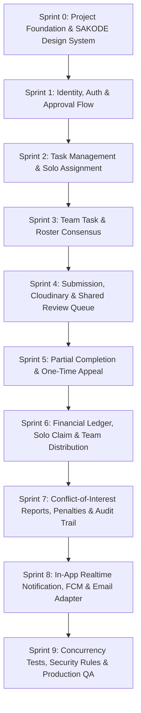

# SAKODE Task & Reward Platform - Master Sprint Roadmap

Roadmap ini membagi seluruh 16 halaman dokumen spesifikasi menjadi 10 sprint atomik yang dapat dieksekusi secara berurutan dan terukur.

---

## Sprint Overview

---

## Rincian Tiap Sprint

### Sprint 0: Project Foundation & SAKODE Design Tokens
* **Fokus**: Inisialisasi Next.js 14+ (App Router), TypeScript, Tailwind CSS, icon pack (Lucide), font Nunito, token warna SAKODE, dan struktur direktori standar.
* **Output Kunci**:
  * `tailwind.config.ts` dengan palet resmi SAKODE (`sakode-cyan`, `sakode-purple`, `sakode-orange`, `sakode-bg`, dll).
  * Setup direktori modular: `src/app`, `src/components`, `src/lib`, `src/types`, `src/server`.
  * Konfigurasi Firebase SDK (Client & Admin) dan helper environment.
  * Shell layout awal yang responsif mobile-first.

### Sprint 1: Identity, Auth & Onboarding Flow
* **Fokus**: Pendaftaran, verifikasi email, login Google, penautan akun (*account linking*), kelengkapan profil, dan alur persetujuan Admin.
* **Output Kunci**:
  * Autentikasi Firebase (Email/Password + Google).
  * Form kelengkapan data member (nama, kontak, skill tags, data rekening/e-wallet terenkripsi).
  * Status akun: `Draft` -> `Pending Approval` -> `Active` (atau `Rejected`).
  * Admin dashboard queue: Registrasi menunggu approval.

### Sprint 2: Task Management & Solo Assignment Core
* **Fokus**: CRUD Task, penentuan mode, deadline UTC/WIB, transaksi atomik Instant Take, dan pembatasan 1 Active Task / 3 Pending Applications.
* **Output Kunci**:
  * Task creation wizard (Admin): Judul, scope, kriteria, Solo/Team, Instant Take/Application, reward (IDR integer), fixed/duration deadline, snapshot Terms.
  * Alur **Instant Take** via transaksi Firestore: verifikasi eligibility & 0 active task.
  * Alur **Application**: maksimal 3 pending applications, auto-withdraw ketika 1 aplikasi terpilih.
  * Server timestamp validation untuk pengecekan deadline tanpa cron.

### Sprint 3: Team Task Management & Roster Locking
* **Fokus**: Pembentukan tim, recruitment link, persetujuan Team Lead, kesepakatan prinsip pembagian reward, dan penguncian roster.
* **Output Kunci**:
  * Pemilihan Team Lead (pengambil pertama atau pemenang seleksi aplikasi).
  * Undangan tim via link / roster application.
  * Persetujuan Terms oleh semua anggota tim & kesepakatan prinsip pembagian (rata atau berbasis kontribusi).
  * Transisi status ke `Active` dan penguncian roster tim (hanya admin yang dapat override jika terjadi situasi darurat).
  * Timer durasi otomatis dimulai saat status berubah menjadi `Active`.

### Sprint 4: Submission, Evidence Upload & Shared Review Queue
* **Fokus**: Pengiriman bukti deliverable via Cloudinary signed upload, review queue admin dengan atomic locking, dan alur revisi.
* **Output Kunci**:
  * Form submission (catatan, link deliverable, upload file JPG/PNG/WebP/PDF max 10MB).
  * Cloudinary API integration: Signed Upload & authenticated delivery metadata.
  * Shared Review Queue Admin dengan status review lock sementara (mencegah tabrakan review antar 4 admin).
  * Opsi review: Setujui, Minta Revisi (dengan batas waktu deadline), Beri Perpanjangan Waktu Manual (dengan alasan wajib), Tolak.

### Sprint 5: Partial Completion, Continuation Task & One-Time Appeal
* **Fokus**: Penanganan pekerjaan sebagian dan hak sanggah member.
* **Output Kunci**:
  * Fitur **Partial Completion**: Menentukan porsi diterima, porsi tersisa, reward parsial (IDR integer), dan catatan evaluasi.
  * Auto-generation **Continuation Task** yang terhubung (*linked*) ke task induk dengan sisa bounty.
  * Alur **Appeal (1 kali kesempatan)**: member mengajukan sanggahan dengan bukti baru, wajib di-assign dan ditinjau oleh Admin lain (bukan admin yang memberi keputusan pertama). Penahanan reward selama appeal berjalan.

### Sprint 6: Financial Ledger, Solo Claim & Team Consensus Distribution
* **Fokus**: Pencatatan reward ledger, pencairan dana solo secara batch, konsensus reward tim 100%, dan verifikasi transfer berjenjang.
* **Output Kunci**:
  * Dokumen `rewardLedgers` per task.
  * Alur Claim Solo: Pemilihan beberapa reward (`Claim All`), snapshot rekening, status: `Available` -> `Claimed` -> `Processing` -> `Paid` -> `Confirmed`. Idempotency key untuk cegah transfer ganda.
  * Konsensus Tim: Team Lead mengajukan alokasi final, seluruh anggota wajib voting setuju (1 penolakan mengembalikan ke musyawarah).
  * Alur Distribusi Tim: Admin transfer ke Team Lead -> Team Lead transfer ke anggota + upload bukti per anggota -> Anggota konfirmasi penerimaan -> Task `Closed`.

### Sprint 7: Conflict-of-Interest Reports, Progressive Penalties & Audit Trail
* **Fokus**: Sistem pelaporan masalah, mitigasi konflik kepentingan, aturan penalti, dan logging aktivitas.
* **Output Kunci**:
  * Form Report terhubung ke Task/Claim/Distribution dengan upload bukti.
  * Aturan Conflict-of-Interest: Admin yang terlibat dilarang mereview laporannya; eskalasi otomatis ke Super Admin.
  * Sistem Penalti Progresif: Warning, Cooldown, Tim-only, Larangan Team Lead, Suspend.
  * Koleksi `auditEvents` yang *append-only* mencatat pelaku, aksi, snapshot before-after, dan alasan.

### Sprint 8: Realtime In-App Notification Center, FCM & Email Adapter
* **Fokus**: Notifikasi instan di dalam aplikasi tanpa membebani keandalan mutasi database utama.
* **Output Kunci**:
  * Realtime notification inbox di Firestore (read/unread, filter kategori).
  * Web Push Notification via Firebase Cloud Messaging (FCM).
  * Email provider adapter untuk event krusial (approval akun, deadline darurat, pencairan dibayar).
  * Non-blocking architecture: kegagalan FCM/email tidak me-rollback transaksi database.

### Sprint 9: Quality Gate, Concurrency Tests & Production Hardening
* **Fokus**: Pengujian batas ekstrem, aturan keamanan Firestore, dan verifikasi kriteria penerimaan MVP.
* **Output Kunci**:
  * Concurrency test: Dua member klik Instant Take bersamaan, dua admin review bersamaan, double claim pada reward yang sama.
  * Firestore Security Rules audit.
  * Responsiveness & accessibility audit (mobile, tablet, desktop).
  * Verifikasi 15 kriteria penerimaan MVP sesuai halaman 16 dokumen spesifikasi.
